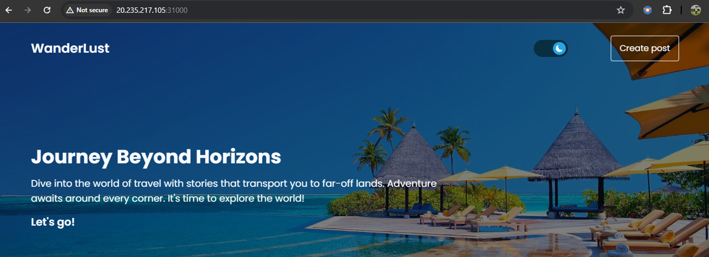

# Wanderlust — Kubernetes, CI/CD and GitOps

A containerized blogging application deployed to Kubernetes, using Jenkins for continuous integration and Argo CD for GitOps configuration.


## Technology Stack

- MERN stack
- Docker
- Kubernetes and Minikube
- Jenkins
- Argo CD
- MongoDB and Redis
- Terraform

## Deployment Evidence

### Application



### Frontend Image Build


### Backend Image Build


### Containers and Images


### Kubernetes


### Argo CD


## Jenkins CI Pipeline

The root Jenkinsfile defines source checkout, backend tests, frontend build, Kubernetes manifest validation, dependency audits, and artifact archiving.

## GitOps

The Argo CD application manifest is at `GitOps/argocd/wanderlust-application.yaml`. It targets the `main` branch and the `kubernetes/` directory. Automated sync is not currently enabled.

## Repository Structure

- `Assets/` — screenshots and workflow image
- `backend/` — backend application
- `frontend/` — frontend application
- `kubernetes/` — Kubernetes manifests
- `GitOps/` — Argo CD configuration
- `terraform/` — Terraform configuration
- `Jenkinsfile` — CI pipeline

## Check Deployment

```bash
minikube status
kubectl get nodes
kubectl get deployments,services,pods -n wanderlust
```

## Scope

This README documents the local Kubernetes deployment and the configuration present in the repository. Production AWS EKS deployment, automated image publishing, and zero-downtime releases are not claimed as verified.

## License

See [LICENSE](LICENSE).
